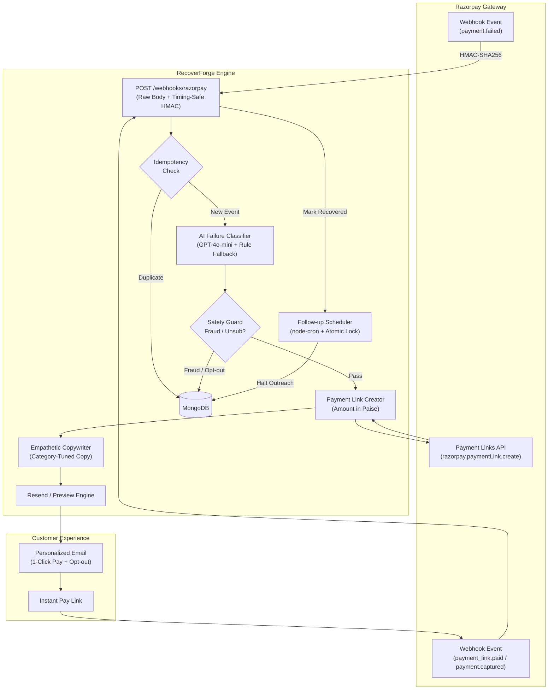

# RecoverForge ⚡ Autonomous AI Agent for Razorpay Payment Recovery

> **Turn failed Razorpay checkouts into settled revenue, autonomously.** RecoverForge intercepts `payment.failed` webhooks, classifies the root cause with GPT-4o-mini, creates a fresh Razorpay Payment Link, and runs a personalised, empathetic email recovery sequence that stops automatically when the customer pays.

*Built for the Razorpay AI Buildathon, Track 3: AI Revenue Recovery.*

| | |
|---|---|
| 🔗 **Live demo** | https://recoverforge.duckdns.org/ |
| 🎥 **5-min pitch video** | https://drive.google.com/file/d/1AKpDet3tbTUtwbtiHDl2fiOr9W94aNOl/view?usp=sharing |
| 👤 **Built by** | Nikunj Kumar ([@nik1062](https://github.com/nik1062)) |


---

## Try it in 60 seconds (no setup)

1. Open the **[live demo](https://recoverforge.duckdns.org/)**.
2. Click **"Test Interactive Demo Store"** on the landing page (or **Demo Checkout** in the sidebar after signing in).
3. Pick a failure category (for example **Insufficient Funds**) and click **Trigger Failure Event**.
4. Go to the **Recovery Dashboard**. A new failed payment appears instantly. Click **Audit Trail** to watch every agent action: webhook received, AI classification, payment link created, email generated, follow-up scheduled.
5. Click **Preview Generated Email**, open the generated Razorpay link, choose Netbanking, and click **Success** on the demo bank page.
6. Refresh the dashboard. The payment is marked **Recovered** and follow-ups are halted automatically.


---

## What problem does it solve?

A significant share of online checkouts in India fail because of insufficient balance, bank 3D-Secure timeouts, UPI app drop-offs, or transient gateway glitches. Merchants lose these customers because:

1. Standard payment-failure messages are sterile error codes that confuse buyers.
2. Merchants have no automated way to generate an instant, one-click alternative payment link.
3. Manual outreach is impossible at scale and usually happens after the buyer has already given up.

**RecoverForge closes the gap.** It notices a failed transaction within seconds, diagnoses the failure mode, generates a 48-hour Razorpay Payment Link, and runs a gentle, context-aware recovery sequence.

---

## System architecture



---

## Core recovery flow

1. **Failure ingestion.** Razorpay sends `payment.failed`. RecoverForge reads the raw request body, verifies the HMAC-SHA256 signature against `RAZORPAY_WEBHOOK_SECRET` using `crypto.timingSafeEqual`, and checks idempotency through `X-Razorpay-Event-Id`.
2. **AI classification.** Telemetry (`errorCode`, `errorReason`, `errorStep`, `errorSource`) is evaluated by `gpt-4o-mini` and categorised as `insufficient_funds`, `bank_decline`, `user_dropoff`, `technical_error`, or `fraud_suspected`. If the model is slow, malformed, or unavailable, a rule-based fallback classifier takes over so recovery never stalls.
3. **Safety evaluation.** Suspected fraud is immediately marked `abandoned` and is **never** emailed.
4. **Link creation.** The agent creates a dedicated Razorpay Payment Link valid for 48 hours.
5. **Empathetic copy.** Email copy is tailored to the failure (gentle reassurance for low balance, a technical apology for gateway glitches). Every email carries the payment link and a one-click opt-out URL.
6. **Follow-ups and auto-halt.** If the payment is still unsettled, the scheduler sends up to 3 follow-ups (+1 day, +3 days, +7 days). When `payment_link.paid` or `payment.captured` fires, the sequence halts immediately.

---

## Engineering highlights

| Challenge | How it is handled |
|---|---|
| **Webhook signature verification** | Razorpay signs the exact raw bytes, so a global `express.json()` breaks the digest. `express.raw()` is scoped to the webhook route only, and signatures are compared with `crypto.timingSafeEqual`. |
| **Duplicate webhook deliveries** | Each `X-Razorpay-Event-Id` is stored under a unique index. A replay returns `200` and does nothing, so no duplicate records, links, or emails. |
| **Scheduler double-send race** | Jobs are claimed atomically with `findOneAndUpdate` (a short lease on `nextActionAt`), and payment status is re-checked right before every send. |
| **LLM reliability and prompt injection** | Forced JSON output, schema validation, customer data delimited inside the prompt, a timeout, and a rule-based fallback classifier. |
| **Money handling** | All amounts are stored as integer paise and converted to rupees only at the UI boundary. |

---

## Tech stack

| Layer | Technology | Purpose |
|---|---|---|
| **Frontend** | React 18 + Vite + Tailwind CSS | Merchant dashboard and audit-trail drawer |
| **Backend** | Node.js + Express | REST APIs, raw webhook stream, rate limiting |
| **Database** | MongoDB + Mongoose | Failed payments, idempotency events, action timelines |
| **Security** | Helmet + HMAC-SHA256 | Signature verification via `crypto.timingSafeEqual` |
| **AI / LLM** | OpenAI `gpt-4o-mini` | Root-cause classification and empathetic copy |
| **Payments** | Razorpay SDK (`^2.9.2`) | Orders, checkout, Payment Links API |
| **Outreach** | Resend API + Nodemailer | Recovery emails (with preview fallback) |
| **Scheduler** | `node-cron` | Multi-day follow-ups with atomic job locks |
| **DevOps** | Docker Compose + GitHub Actions | CI testing and EC2 PM2 deployment |

---

## Run it locally

### Prerequisites
- Node.js 18+
- MongoDB running locally, or an Atlas URI
- Razorpay test-account credentials
- OpenAI API key (optional: the rule-based fallback is used if omitted)

### Option A: Local development
```bash
# 1. Clone
git clone https://github.com/nik1062/RecoverForge.git
cd RecoverForge

# 2. Backend
cd backend
npm install
cp .env.example .env
# fill in your keys in .env
npm run dev        # http://localhost:5000

# 3. Frontend (new terminal)
cd ../frontend
npm install
npm run dev        # http://localhost:5173
```

### Option B: Docker Compose
```bash
docker-compose up -d
```

### Environment variables

Configure these in `backend/.env` (see `.env.example`):

| Variable | Description |
|---|---|
| `PORT` | Backend port (default `5000`) |
| `NODE_ENV` | `development` or `production` |
| `FRONTEND_URL` | Allowed CORS origin (for example `http://localhost:5173`) |
| `MONGODB_URI` | MongoDB connection URI |
| `JWT_SECRET` | Secret for auth tokens (the server refuses to start without it) |
| `RAZORPAY_KEY_ID` | Razorpay Key ID |
| `RAZORPAY_KEY_SECRET` | Razorpay Key Secret |
| `RAZORPAY_WEBHOOK_SECRET` | Secret configured in the Razorpay dashboard webhook |
| `DEFAULT_MERCHANT_ID` | Fallback merchant ID if not given in checkout notes |
| `OPENAI_API_KEY` | OpenAI API key for `gpt-4o-mini` |
| `RESEND_API_KEY` | Resend API key (optional: preview mode is used if omitted) |
| `SMTP_HOST` / `SMTP_USER` / `SMTP_PASS` | SMTP settings for merchant OTP verification |

> Never commit your real `.env` file or API keys.

---

## Demo data and Razorpay test cards

**Interactive simulation:** use **Demo Checkout** in the app and trigger a failure event. The platform runs classification, creates a payment link, generates the email, and updates the dashboard in real time.

**Razorpay test cards (Test Mode):**

| Card ending | Outcome |
|---|---|
| `3335` | Insufficient balance |
| `0002` | Bank decline |
| `1111` | Successful payment (OTP `123456`) |

**Seed a realistic demo dataset:**
```bash
cd backend
npm run seed:demo            # 20 varied failures with full audit timelines
npm run seed:demo -- --reset # clear the seeded records
```
Seeded rows carry a "Demo" badge and can be toggled on or off in the dashboard.

---

## Automated tests

```bash
cd backend
npm test
```

Jest + Supertest cover:
- Health-check endpoint
- Webhook signature validation (valid vs invalid)
- Webhook event idempotency
- AI classifier fallback on timeout or offline
- Scheduler concurrency and race-condition safety
- Seed script idempotency

---

## Honest limitations

1. **Rule-based timing.** Follow-up timing uses deterministic heuristics (for example, `retry_next_morning` maps to the next 9:00 AM IST). The system does not learn per-customer timing.
2. **Email delivery fallback.** If `RESEND_API_KEY` is not set, the agent stores the generated email as a preview in the timeline instead of sending it, so the project can be evaluated without a paid mail account.
3. **Reused scaffolding.** Auth, billing, and deployment scaffolding were reused from my earlier project, ColdMailForge. All recovery-agent logic was built for this buildathon.

---

## What's next

- WhatsApp recovery channel
- Smarter, data-driven retry timing
- Multi-merchant support

---

*Built with care for the Razorpay AI Buildathon by [Nikunj Kumar](https://github.com/nik1062).*
