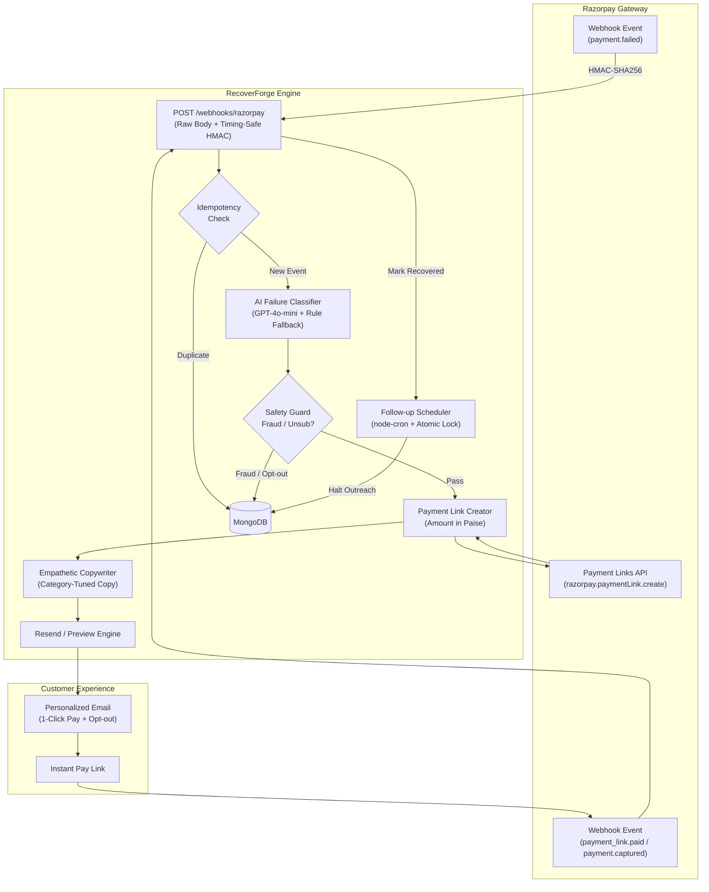

# RecoverForge ⚡ — Autonomous AI Agent for Razorpay Payment Recovery
> **Turn failed Razorpay checkouts into settled revenue autonomously.** RecoverForge intercepts `payment.failed` webhooks, classifies root causes via GPT-4o-mini, generates fresh Razorpay Payment Links, and conducts personalized, empathetic email recovery cadences that stop automatically when the customer pays.

*Built for the Razorpay AI Buildathon — Track 3: AI Revenue Recovery.*

---

## What Problem Does It Solve?

In Indian online commerce, over **20% of checkouts fail** due to insufficient balance, bank 3D-Secure timeouts, UPI app drop-offs, or transient gateway network glitches. Today, merchants lose these customers permanently because:
1. Standard payment failure notifications are sterile, robotic error codes that confuse buyers.
2. Merchants have no automated mechanism to generate an instant, 1-click alternative payment link.
3. Sending manual outreach is impossible at scale and often triggers after the buyer has already abandoned.

**RecoverForge bridges the gap:** It perceives failed transactions within seconds of occurrence, diagnoses the exact failure mode using telemetry semantics, generates a 48-hour Razorpay Payment Link, and runs a gentle, context-aware recovery sequence.

---

## System Architecture



---

## Tech Stack

| Layer | Technology | Purpose |
|---|---|---|
| **Frontend** | React 18 + Vite + Tailwind CSS | Responsive merchant dashboard & audit trail drawer |
| **Backend** | Node.js + Express | REST APIs, raw webhook stream, rate-limiting |
| **Database** | MongoDB + Mongoose | Failed payments, idempotency events, action timelines |
| **Security** | Helmet + HMAC-SHA256 | Cryptographic verification via `crypto.timingSafeEqual` |
| **AI / LLM** | OpenAI `gpt-4o-mini` | Root-cause telemetry classification & empathetic copy |
| **Payments** | Razorpay SDK (`^2.9.2`) | Orders, checkout, and Payment Links API |
| **Outreach** | Resend API + Nodemailer | Recovery dispatch (with automated preview fallback) |
| **Scheduler** | `node-cron` | Multi-day follow-up cadences with atomic job locks |
| **DevOps** | Docker Compose + GitHub Actions | Automated CI testing & EC2 PM2 deployment |

---

## Core Recovery Flow

1. **Failure Ingestion:** Razorpay dispatches `payment.failed`. RecoverForge parses the raw request stream, verifies the HMAC-SHA256 signature against `RAZORPAY_WEBHOOK_SECRET` using `crypto.timingSafeEqual`, and checks idempotency via `X-Razorpay-Event-Id`.
2. **AI Classification:** Telemetry (`errorCode`, `errorReason`, `errorStep`, `errorSource`) is evaluated by `gpt-4o-mini`. The agent categorizes the failure into `insufficient_funds`, `bank_decline`, `user_dropoff`, `technical_error`, or `fraud_suspected`.
3. **Safety Evaluation:** Suspected fraud or high-risk transactions are immediately marked `abandoned` and **never** emailed.
4. **Link Creation:** The agent creates a dedicated Razorpay Payment Link (`razorpay.paymentLink.create`) preserved for 48 hours.
5. **Empathetic Copy Generation:** Copy tailored to the failure is synthesized (e.g. gentle reassurance for low balance; technical apology for gateway glitches). Every email contains the payment link and a 1-click opt-out URL.
6. **Follow-up Cadence & Auto-Halt:** If unsettled, the scheduler attempts a maximum of 3 follow-ups (+1 day, +3 days, +7 days). When `payment_link.paid` or `payment.captured` fires, the sequence halts instantly.

---

## Quick Start & Local Run

### Prerequisites
* Node.js 18+
* MongoDB running locally or Atlas URI
* Razorpay Test Account credentials
* OpenAI API Key (optional: rule-based fallback active if omitted)

### Option A — Local Development
```bash
# 1. Clone repository
git clone https://github.com/nik1062/RecoverForge.git
cd RecoverForge

# 2. Setup backend
cd backend
npm install
cp .env.example .env
# Fill your keys in .env
npm run dev # Starts on port 5000

# 3. Setup frontend
cd ../frontend
npm install
npm run dev # Starts on port 5173
```

### Option B — Docker Compose
```bash
docker-compose up -d
```

---

## Environment Variables

Configure these in `backend/.env` (reference: `.env.example`):

| Variable | Description |
|---|---|
| `PORT` | Backend server port (standardized to `5000`) |
| `NODE_ENV` | `development` or `production` |
| `FRONTEND_URL` | Allowed origin for CORS (e.g. `http://localhost:5173`) |
| `MONGODB_URI` | MongoDB connection URI |
| `JWT_SECRET` | Secret key for auth tokens (server refuses startup if missing) |
| `RAZORPAY_KEY_ID` | Razorpay Key ID |
| `RAZORPAY_KEY_SECRET` | Razorpay Key Secret |
| `RAZORPAY_WEBHOOK_SECRET` | Secret configured in Razorpay dashboard webhooks |
| `DEFAULT_MERCHANT_ID` | Fallback merchant ID if not specified in checkout notes |
| `OPENAI_API_KEY` | OpenAI API key for `gpt-4o-mini` |
| `RESEND_API_KEY` | Resend API key (optional: preview mode active if omitted) |
| `SMTP_HOST` / `SMTP_USER` / `SMTP_PASS` | SMTP configuration for merchant OTP verification |

---

## Running the Interactive Demo

1. Open **http://localhost:5173/demo-store**.
2. **Interactive Simulation:** Click **"Simulate Payment Failure"**. The platform generates a live failure, runs classification, creates a payment link, synthesizes email copy, and updates the Recovery Dashboard in real-time.
3. **Simulating via Razorpay Test Cards:**
   - Card ending in `3335`: Simulates **Insufficient Balance**.
   - Card ending in `0002`: Simulates **Bank Decline**.
   - Card ending in `1111`: Simulates **Successful Payment**.
4. **Seed Realistic Demo Dataset:**
   ```bash
   cd backend
   npm run seed:demo
   ```
   Generates 20 varied failure transactions with complete audit timelines. Markings display with an explicit "Demo data" badge and can be toggled on/off in the dashboard.
   ```bash
   # To clear seeded demo records:
   npm run seed:demo -- --reset
   ```

---

## Running Automated Tests

```bash
cd backend
npm test
```
Executes Jest + Supertest verification covering:
* Health check endpoint status
* Webhook signature validation (valid vs invalid)
* Webhook event idempotency
* AI classifier fallback on timeout/offline
* Scheduler concurrency & race-condition safety
* Seed script idempotency

---

## Honest Limitations

1. **Deterministic Timing Heuristics:** Timing is mapped via rule-based scheduling (e.g. `retry_next_morning` maps to next 9:00 AM IST for salary/balance refresh). We do not claim dynamic per-customer biometric timing learning.
2. **Email Delivery Fallback:** If `RESEND_API_KEY` is omitted, the agent logs the generated copy into timeline metadata rather than sending real emails, allowing seamless local evaluation without paid mail accounts.
3. **Credit Gateway Scaffolding:** Auth, billing and deployment scaffolding reused from my earlier project ColdMailForge; all recovery-agent logic was built for this buildathon.
